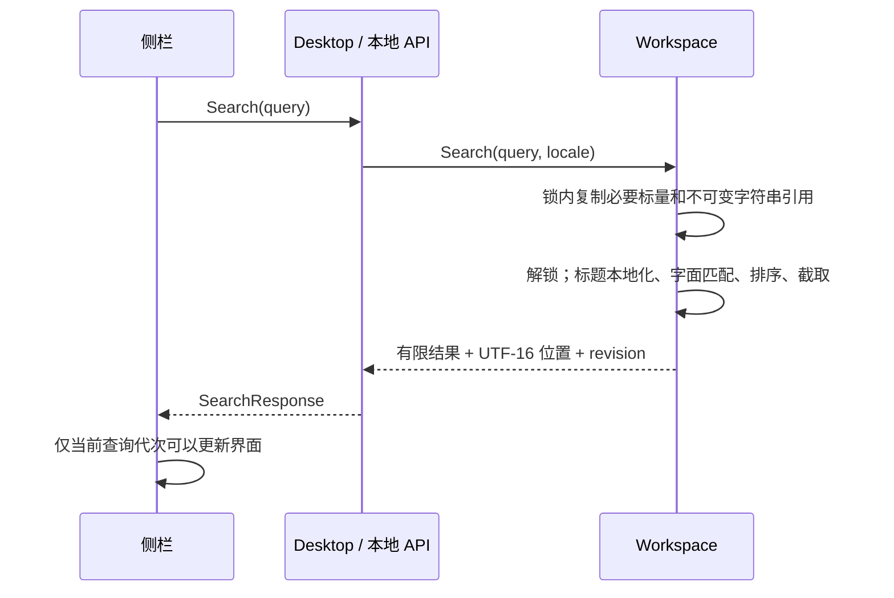

# 全文搜索 设计

**日期**：2026-10-28  
**状态**：已实施；AC-1 至 AC-10 的实测与验收见配套实施计划，原生验证边界在记录中单独说明。  
**来源**：用户要求「先出具全文搜索的设计文档和实施计划」。  
**基线**：留白 0.6.6，`8bf8e58`；Go + MyGo 0.7.1、TypeScript + CodeMirror 6。  
**实施计划**：[全文搜索 实施计划](../plans/2026-10-28-full-text-search.md)。

## 目标与现状

用户记得某篇文稿中的一句话时，能从侧栏找到文稿，看见命中上下文，并打开到对应位置。

当前代码中的搜索已有两层：

- `src/app.ts:189–212` 的侧栏搜索在 `state.recent` 上匹配「标题 + 摘要」，并非只匹配标题。
- `summary.go` 的 `excerptOf` 跳过 front matter，只读取正文前 4096 字节，再截取最多 90 个字符；正文后面的内容因此搜不到。
- `workspace.go:574–592` 的 `snapshot` 返回全部登记文稿的摘要，没有 30 篇数量上限。
- `src/app.ts` 的 `find` 动作使用 CodeMirror 文内查找，继续保留其快捷键、正则和替换能力。
- `Workspace.docs` 在启动时恢复持久草稿，也保存曾打开文件的工作副本。搜索无需另建文件库。

本设计以代码为依据，修正前期调研中“只能搜标题”的描述。未发现必须由用户先裁决的阻塞项；下列匹配规则、展示上限和性能预算均为本次提出的默认方案，尚未做性能实测。

## 范围

### 本次包含

1. 在原有侧栏搜索框中搜索工作区全部已登记文稿的标题和完整 Markdown 内容。
2. 中文、英文、数字、标点的字面子串搜索；英文等大小写折叠采用 Unicode simple case folding。
3. 按文稿分组的结果、命中片段、行号、片段高亮和点击定位。
4. 编辑、分栏、阅读三种视图下的导航，保持用户当前视图偏好。
5. 输入防抖、异步响应失效保护、自动保存后的结果刷新，以及中英文文案和键盘操作。
6. 无文件写入副作用的查询接口、性能基准和可靠性回归。

### 本次不包含

- 扫描任意目录、搜索从未在留白中打开的文件，或搜索已移除、废纸篓、隔离目录中的文稿。
- 拼音、模糊、语义搜索、分词、多词 AND/OR、用户正则和跨文稿替换。
- 图片 OCR、附件内容、网页抓取，或渲染后纯文本搜索。
- 数据库、持久索引、新依赖、搜索历史、标签、双链和多窗口。
- 在阅读 DOM 中逐字标记所有命中，或改造每一种块组件的内部搜索 UI。

## 查询对象与一致性

**登记文稿**指查询快照时仍存在于 `Workspace.docs` 中的文稿，包括未命名草稿、持久草稿、关联本地文件的工作副本及尚未移除的恢复文稿。

搜索读取后端当前接受的工作副本，包含 front matter、代码、链接地址、HTML 源码和脚注。文件外部变化按已有 `Status` / `Activate` 流程发现和处理；查询本身不刷新磁盘，也不解决冲突。例如：

- `**加粗文字**` 可以用「加粗文字」找到。
- `甲**乙**` 不会被「甲乙」找到，因 Markdown 源码中二者不连续。
- `tags: [写作]`、代码中的变量和图片地址均可搜索。
- 另一应用刚改过一个非当前文件时，结果可能来自留白先前接受的副本。点击打开时会检查磁盘并校验版本。

前端尚未自动保存的输入不随每次查询上传，也不为查询强制保存。查询有结果时，如当前存在待保存输入，显示简短状态“当前修改自动保存后会更新结果”；正常内容保存成功后自动重查。若保存失败，显示“结果暂不包含当前未保存的修改”，保留现有保存错误提示。已成功保留为草稿、但原文件写入失败的内容属于搜索范围。

这是一份有明确时点的搜索快照，不能承诺所有文件的实时磁盘状态。

## 匹配规则与限额

| 项目 | 首版规则 |
|---|---|
| 查询规范化 | 去掉首尾空白；空串恢复原有最近列表 |
| 查询长度 | 规范化后最多 128 个 Unicode 码点；非法 UTF-8、超长或包含内部 CR/LF 的查询返回本地化错误 |
| 匹配 | 单个连续字面子串，忽略大小写；不进行 Unicode NFC/NFKC 规范化，不把 `ß` 扩展为 `ss` |
| 实现 | Go 标准库 `strings.IndexAny` 跳过不可能的首字符，再用锚定 `(?i)^` + `regexp.QuoteMeta(query)` 验证候选；首字符集合覆盖 `unicode.SimpleFold` 完整循环，用户不能传入正则语义 |
| 中文 | 无最短长度限制，单个汉字也可搜索 |
| 标点 | `.`, `*`, `[`, `(` 等按原样匹配 |
| 排序 | 标题命中文稿优先；同组按 `Updated` 降序、ID 升序 |
| 展示上限 | 最多 100 篇文稿；每篇最多 3 个正文命中，按原文位置升序 |
| 更多命中 | 每篇最多探测第 4 个命中，据此返回 `moreHits`；不统计整篇的精确命中数 |
| 文稿总数 | 扫描全部快照，返回精确匹配文稿数 `total`；超过 100 篇时 `truncated=true` |
| 片段 | 命中前最多 32 个码点、命中原文、后最多 40 个码点；不跨行，截断处加省略号 |
| 保留时间 | 查询和结果仅保存在当前界面会话，不写入设置或搜索历史 |

Unicode simple folding 包括部分非英文字符的折叠，采用 Go 的实际语义；前端不再实现另一套匹配算法。结果位置始终映射回原文，不以大小写转换后的字符串偏移定位。

## 交互

### 入口与结果

沿用 `#recent-search`；占位文案改为“搜索文稿标题与内容…” / “Search document titles and content…”。不新增工具栏按钮、快捷键或搜索模式开关。

查询为空时，最近列表、移除操作和排序维持原有行为。查询非空时：

1. 停止输入 180 ms 后发起查询。旧结果立即失去可点击性，列表标记搜索中。
2. 每篇显示标题；关联文件显示文件名和父目录提示，草稿显示“草稿”，以区分同名文稿。
3. 标题第一次命中用 `<mark>` 标记；下方列出最多三个正文片段及行号。
4. 点击片段定位到该命中；点击文稿标题默认定位到第一个正文命中。只有标题命中时，恢复该文稿原有位置。
5. 状态显示“找到 N 篇文稿”。截断时显示“显示前 100 篇，请缩小搜索范围”；`moreHits` 显示“还有更多匹配，可在文内继续查找”。
6. 非空查询结果不提供删除按钮；清空查询后继续使用原有最近列表的移除流程。

搜索结果中的标题、路径、片段和查询均用文本节点构造；高亮只包裹服务端给出的原文范围，不使用 `innerHTML`。

### 状态、键盘与可访问性

| 状态或操作 | 行为 |
|---|---|
| 查询为空 | 展示原有最近文稿，不调用 `Search` |
| 请求进行中 | 标记 `aria-busy`，显示“正在搜索…”，保留输入焦点 |
| 无命中 | “没有找到包含「查询」的文稿” |
| 请求失败 | 显示本地化错误及重试按钮；不显示旧查询为当前结果 |
| 搜索框 IME 组合中 | 不查询、不响应 Enter 打开；`compositionend` 后正常防抖 |
| 正文 IME 组合中 | 不切换文稿，沿用现有“先完成输入”保护 |
| 搜索框 ↓ / Enter | ↓ 聚焦第一条可操作结果；Enter 打开第一篇，组合输入时除外 |
| 结果 ↑ / ↓ | 在文稿标题和命中按钮间移动；Enter 打开当前项 |
| 结果 Esc | 返回搜索框；搜索框 Esc 先清空查询，再次按时按现有侧栏行为关闭或返回正文 |
| 结果更新 | 焦点仍留在搜索框；如聚焦结果，按文稿 ID + 命中位置尽力保留，消失时回搜索框 |
| 状态播报 | 使用独立 `role=status` / `aria-live=polite`，不为每个片段播报整段内容 |

沿用普通按钮与分组语义，不声明未实现完整交互的 ARIA combobox/listbox。颜色只使用 `DESIGN.md` 已有角色；正文高亮使用 `--highlight` / `--foreground`，所有十一套主题可读，窄侧栏片段换行。

### 点击后的可靠导航

点击结果属于文稿导航操作，查询本身仍为只读：

1. 通过现有 `run` / `saveForAction` 完成当前输入的安全保存；失败或组合输入未结束时不离开当前文稿。
2. 调用 `Activate(id)`，允许已有逻辑发现磁盘变化和冲突；不调用 `Overwrite` / `Reload` 自动解决冲突。
3. 使用返回的当前文稿校验 ID、`revision`、范围合法性，以及原文 `slice(from,to) === text`。
4. 校验通过后定位；失败时只按正常方式打开文稿，提示“文稿内容已更新，请重新选择搜索结果”，立即刷新结果，不套用旧偏移。
5. 文稿已移除时保留当前文稿，刷新结果并提示“文稿已移除”。

同一篇、内容没有变化的导航保留当前 `EditorView` 与撤销历史；切换或磁盘内容改变时沿用 `load`。结果导航的生命周期独立于查询响应生命周期，避免 `load` 触发重查后取消刚选中的合法定位。

`load` 当前在 `requestAnimationFrame` 中恢复保存的滚动位置。实施时必须给它一个明确的搜索定位覆盖点：验证过的目标在默认滚动恢复之后应用，并检查当前 view、文稿 ID 和导航代次；较旧的回调不得抢回新文稿的滚动位置。

### 三种视图的定位边界

| 视图 | 定位表现 |
|---|---|
| 编辑 / 分栏左侧 | CodeMirror 选择原文命中范围，并滚动到范围；不写入正文、不进入撤销栈 |
| 即时排版的表格、图片、公式等 | 定位到对应原文范围及所属块；不承诺组件内部逐字高亮，结果片段始终保留准确高亮 |
| 已折叠 `<details>` | 复用现有 `createDetailsFolding` 在选择进入折叠范围时展开的行为 |
| 分栏右侧 / 阅读 | 显式按源行号滚动到对应预览块，打开目标所在的 `<details>`；不会被普通软跟随的“同块去重”吞掉 |
| 渲染后不可见的源码 | 定位到所属或最近预览块，并提供“在源码中查看”操作；用户点击后才使用已有分栏 + 源码视图操作 |

“在源码中查看”针对当前已校验的命中再次检查版本与文本；它是用户显式改变视图的动作。普通结果点击不改变布局、源码、主题或字号偏好。

预览显式定位使用即时滚动，支持尚未完成渲染时的待定位目标；文稿切换使旧目标失效。定位完成后手动滚动仍独立，不把搜索定位变成持续的滚动同步。原生 IME 行为需另做桌面验证，浏览器合成事件不能替代该证据。

## 接口与实现边界

新增 `search.go`，承载搜索数据类型、匹配、快照和结果构造；不把扫描算法加入 `workspace.go` 或前端入口的大函数。

### 后端契约

```go
type SearchRange struct {
    From int `json:"from"`
    To   int `json:"to"`
}

type SearchHit struct {
    From   int    `json:"from"`
    To     int    `json:"to"`
    Line   int    `json:"line"`
    Text   string `json:"text"`
    Before string `json:"before"`
    After  string `json:"after"`
}

type SearchItem struct {
    ID         string       `json:"id"`
    Title      string       `json:"title"`
    Path       string       `json:"path"`
    Updated    int64        `json:"updated"`
    Revision   int          `json:"revision"`
    TitleMatch *SearchRange `json:"titleMatch"`
    Hits       []SearchHit  `json:"hits"`
    MoreHits   bool         `json:"moreHits"`
}

type SearchResponse struct {
    Items     []SearchItem `json:"items"`
    Total     int          `json:"total"`
    Truncated bool         `json:"truncated"`
}
```

- `Workspace.Search(query, locale string) (SearchResponse, error)`：按调用语言处理显示标题，然后匹配；空查询返回空数组，由前端恢复最近列表。
- `Desktop.Search(query string)`：传入当前原生语言。
- `/api` 的 `Search` 分支：传入请求自己的 `req.Locale`，不改变应用全局语言。两入口调用同一个工作区方法。
- `src/types.ts` 增加等价类型；前端沿用 `call<SearchResponse>('Search', query)`，不复制全库正文。
- `TitleMatch` 是显示标题的 UTF-16 半开区间；`From/To` 是正文的 UTF-16 半开区间；`Line` 从 1 开始。
- `Hits` / `Items` 始终序列化为数组，不能返回 `null`。

语言切换会重查，因为自动生成的“未命名文稿”和恢复后缀的显示标题可能改变；正文、路径、自定义标题和片段不被翻译。利用已有 `documentIn` / 标题本地化规则，但在脱离锁的快照上执行；已本地化的搜索响应不再经另一套标题转换。

### 快照与匹配流程



锁内只复制 ID、标题所需字段、路径、更新时间、revision、Content 字符串引用；不保留可变 `*Document`，不复制正文缓冲、不读取 `ImageAliases` 等 map。Go 字符串不可变，文稿更新会替换引用，查询可安全持有旧快照。

查询局部编译字面匹配器，每篇标题取第一次命中，正文最多取四次非重叠命中；排序截取后，只为展示的最多 100 篇构造片段。首字符候选和原始正则匹配都使用原文 UTF-8 字节范围，顺序遍历原文累计 UTF-16 长度与换行数，转为编辑器坐标；不能直接把字节偏移、码点数量或折叠文本偏移交给 CodeMirror。匹配器在锁外运行；候选优化以原来的非锚定字面正则为对照验证，产品匹配规则不变。

片段按码点边界截取；`text` 精确保留原始大小写和字符。为返回的小片段复制必要字符串，避免长期保留一个小切片却引用旧的 8 MB 文稿。复杂度随查询扫描的文稿总字节数增长；展示上限不等于扫描上限，不把超大工作区的成本隐藏为“固定耗时”。

查询不调用 `State`、`check`、`persist`、`SavePosition`，不清空通知、不改 `current`、revision、更新时间或磁盘文件。

### 前端职责

新增 `src/search.ts` 承载侧栏搜索控制、状态、结果 DOM 和键盘操作。`src/app.ts` 只连接现有侧栏开关、保存事件、文稿变动和结果导航；不用字符串方法分派的新框架或通用搜索服务。

每次查询文本改变、语言改变、文稿内容保存成功、新建/移除/重命名、随手记到达或已加载外部更新时，增加查询代次。每个控制器最多一个请求在途，后面仅保留最新待查任务；旧响应及旧错误均不更新 UI。清空、关闭或处于搜索框组合输入时也使旧请求失效。位置保存不重查，查询不调用 `setBusy` 锁住正文。

查询代次应在内容变更发生时立即失效，内容保存成功后再发起重查；不能让保存前的响应在这段间隙重新变成可点击结果。重开侧栏若保留查询，先重查。

## 性能目标与失败处理

以下是实施后的验收目标，不是已测成绩：

| 项目 | 目标与测法 |
|---|---|
| 后端查询 | M2 Pro、预加载工作区；300 × 约 32 KiB + 一篇 8 MiB 文稿，未命中/文尾命中/高频命中三类，三轮 Go benchmark 的每次查询均值中位数 ≤ 250 ms |
| 界面响应 | 1000 × 约 4 KiB 文稿；正常环境连续 30 次不同查询，从最后输入到结果完成（含防抖、IPC、DOM）P95 ≤ 600 ms |
| 热路径 | 现有 `check-performance` 与启动包预算继续通过；查询不增加每次击键的全库扫描 |
| 查询并发 | 快速输入或连续自动保存时，每个页面最多一个 `Search` 请求在途 |
| 结果内存 | 返回最多 100 篇、每篇 3 个片段，不返回 Content，不创建全库小写副本或持久缓存 |

正确性测试不以某次 CI 的绝对耗时作随机失败条件；性能门槛在固定机器与记录环境上验证。若达不到目标，先分析匹配器、片段或 DOM 的具体成本，在相同产品契约下调整实现并更新计划；不自动引入数据库或放宽预算。

超出验收数据规模时仍完整查询，允许显示搜索中；不悄悄截断搜索范围。单请求排队可能让新查询等待旧查询完成，这是首版无后端取消机制的已知限制。

## 验收标准

- **AC-1 范围**：正文 4096 字节之后的独特词、超过 30 篇位置的文稿、重启恢复的草稿均可找到；未登记文件、移除文稿、废纸篓和隔离目录不在结果内。
- **AC-2 匹配**：单汉字、中英混排、大小写和字面正则符号按上述规则匹配；空白查询恢复最近列表；超长、非法 UTF-8、内部换行返回明确错误。
- **AC-3 展示**：同名文稿能区分；排序稳定；正文命中按位置升序，100 篇 / 3 片段上限与 `total`、`truncated`、`moreHits` 一致；HTML 输入只能显示为文字。
- **AC-4 坐标**：中文、非 BMP emoji、Unicode 大小写折叠和 CRLF/BOM 文件导入后，返回范围能在当前内部 LF 原文中选中精确 `text`；片段不截断 UTF-8 字符。
- **AC-5 查询只读**：同一查询前后工作区当前 ID、内容、revision、更新时间、通知、草稿与原文件字节均不变化；不触发磁盘重载或冲突决策。
- **AC-6 异步与输入**：旧响应/错误不覆盖新查询、空查询或新语言；最多一个查询在途；搜索框组合输入不查询，正文组合输入不导航；内容自动保存后刷新，位置保存不重查。
- **AC-7 导航**：点击保留当前文稿的输入与撤销历史；定位不进入正文撤销栈；版本失效不使用旧范围，已移除结果不切到错误文稿，当前保存失败不切换。
- **AC-8 视图**：编辑、分栏、阅读能定位到目标范围或预览块；默认滚动恢复不覆盖搜索定位，旧回调不覆盖新文稿；折叠内容可展开；只有显式“在源码中查看”改变视图，预览手动滚动继续独立。
- **AC-9 界面**：中英文、十一主题、窄侧栏、空状态/错误/重试和键盘流程可用；结果刷新不抢输入焦点，文内查找与现有移除确认行为保留。
- **AC-10 性能与回归**：完成上述数据规模的基准与响应测试，满足预算；Go、TS、国际化、现有编辑器/启动资源和相关侧栏、阅读、分栏回归通过。

## 设计自审

本次仅采用方案对照，未模拟用户访谈或宣称用户已确认参数。已消除三个具体歧义：

1. “全文”是完整 Markdown 工作副本，不是整个硬盘或渲染后纯文本。
2. “实时”是接受内容后的快照刷新，不让搜索顺便执行保存、读盘或冲突处理。
3. “高亮”首先保证结果片段；替换组件和渲染后不可见源码的精确查看，使用用户显式打开源码的路径。

待用户审阅的可调整默认值是匹配规则、180 ms 防抖、100 篇 / 每篇 3 片段上限和性能目标；它们不阻塞出具实施计划。
